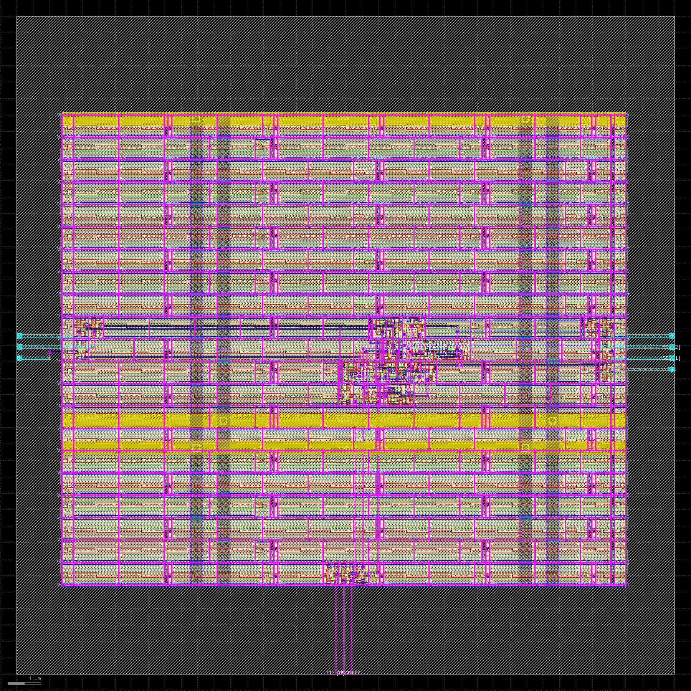
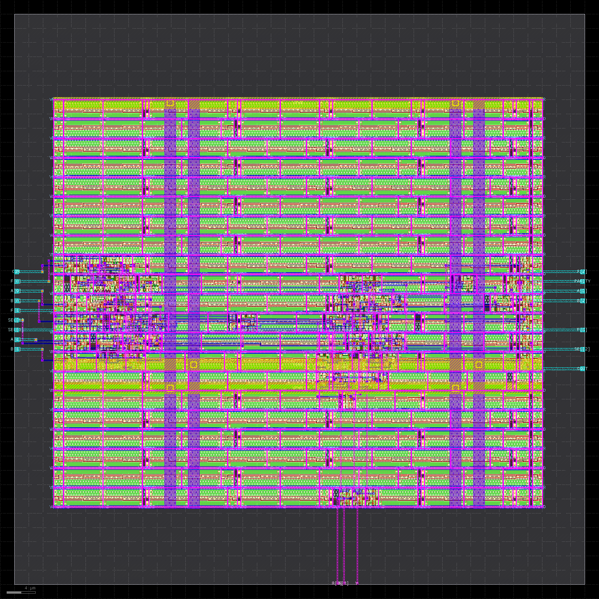
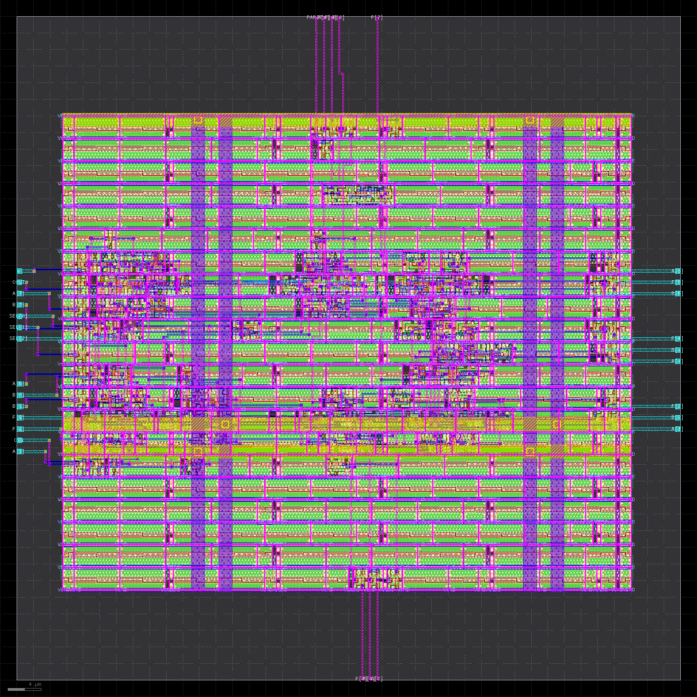
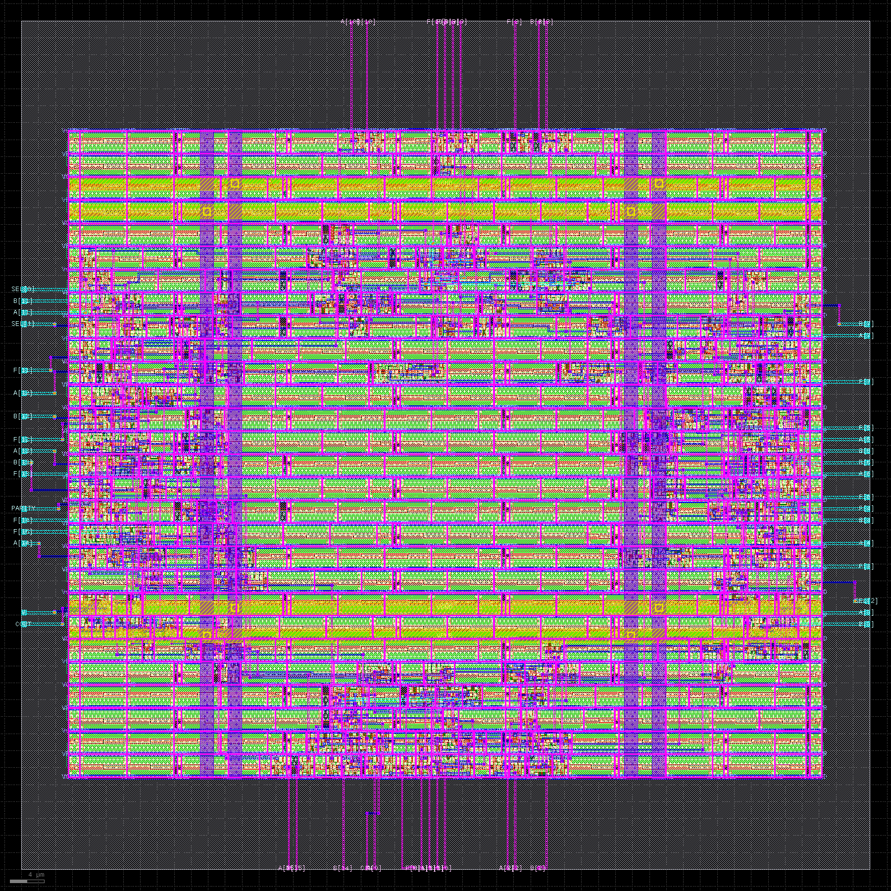

# Reversible ALU (12 operations) and SKY130 physical implementation

Based on: L. Gopal et al., "Design and Synthesis of Reversible Arithmetic and
Logic Unit (ALU)," IEEE I4CT 2014. Parameterized 1/4/8/16-bit ALU with the
paper's Table 1 function table (8 arithmetic + 4 logic operations).

Two implementations of the same function table:

| | A. Reversible-gate ALU (main) | B. Conventional RTL ALU |
|---|---|---|
| Files | `src/rev_gates.v`, `src/rev_alu_gates.v` | `src/rev_alu.v`, `rev_alu_top.v`, `rev_alu_wrappers.v` |
| Built from | Feynman, Peres, Fredkin, HNG, NOT gates only | ordinary RTL, ripple-carry adder |
| Verified | simulation (exhaustive, all widths) | simulation + RTL-to-GDS on SKY130A |
| Outputs | F, COUT | F, COUT, V (overflow), PARITY |

## Function table
`SEL = {S2,S1,S0}`. **S2 = 0:** `F = A + Y + CIN`, Y by `{S1,S0}`:
00 -> 0 (Transfer / Increment), 01 -> B (A+B / A+B+1), 10 -> ~B (A+B' / A-B),
11 -> all ones (A-1 / Transfer). **S2 = 1:** 00 OR, 01 XOR, 10 AND, 11 NOT A.
(The paper's Table 1 lists identical inputs for OR/XOR and AND/NOT; this is a
typo. The assignment above is the one implemented.)

## A. Reversible-gate ALU
Per 1-bit slice: 16 gates, 8 constant inputs, 12 garbage outputs, quantum cost
50 (NOT 1, Feynman 1, Peres 4, Fredkin 5, HNG 6; fan-out not costed).
The gate-level mapping is original, not a copy of the paper's Fig. 6 control
unit. These counts use a different accounting from the paper's Table 3 and
must not be compared with it directly. No physical implementation was done
for this version.

## Simulation (Icarus Verilog): all PASS, 0 errors
```bash
bash simulate.sh
```
1. Gate reversibility and reversible ALU == RTL ALU equivalence: 104,096 checks.
2. Exhaustive testbench, reversible ALU, 1/4/8/16-bit: 222,784 checks.
3. Exhaustive testbench, RTL ALU (incl. COUT, V, PARITY): 222,784 checks.

Waveforms: `src/tb_wave.v`, plotted by `src/plot_wave.py`
(`images/wave_16bit.png`, `images/wave_all.png`).

## B. SKY130 implementation (LibreLane, sky130_fd_sc_hd)
RTL ALU only (standard cells, not reversible gates). Per width:
`bash run_widths.sh`; combined chip: `librelane config.json`.
Clock: none; virtual clock 40 ns; delay = 40 ns minus worst setup slack.

| Bits | Area (um^2) | Delay typ (ns) | Delay slow (ns) | DRC | LVS |
|---|---|---|---|---|---|
| 1 | 217.7 | 1.35 | 2.78 | 0 | 0 |
| 4 | 470.5 | 2.30 | 4.71 | 0 | 0 |
| 8 | 817.0 | 3.37 | 6.86 | 0 | 0 |
| 16 | 1556.5 | 5.00 | 10.18 | 0 | 0 |

Typical corner 1.8 V / 25 C; slow corner 1.6 V / 100 C. Area is placed
standard-cell area (includes tap cells). Values re-read from
`results/w*/metrics.json`. GDS and netlists are in `results/`; layout images
are in `images/`.

These are post-layout ASIC numbers; the paper's 7-9 ns are FPGA (Quartus II)
numbers, so they are not directly comparable.

## Layouts
 
 

## Known limitations
- B is not reversible; quantum cost / garbage outputs are not defined for it.
- PARITY in B is parity of F, not the paper's parity-preserving fault check.
- No power analysis. Two `RSZ-0020` floating-net warnings appeared in the flow log.
"# IC-fabrication" 
